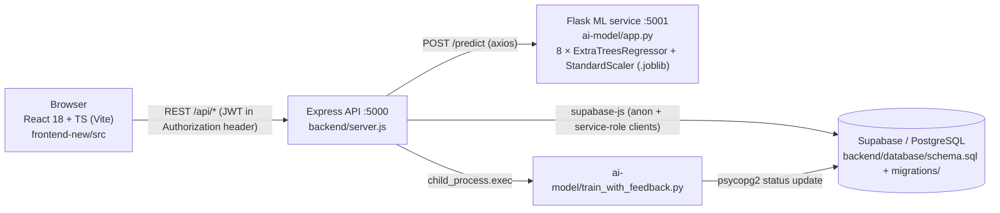

# Daqeeq — Architecture

Daqeeq predicts how much of eight cleaning supplies a facility will consume over a period (toilet paper, hand soap, disinfectant, air freshener, glass cleaner, trash bags, tissues, and cleaning workers), then turns the forecast into quotation requests to service providers. Four roles: `client`, `supplier`, `service_provider`, `admin`. UI is English/Arabic with RTL (`frontend-new/src/i18n/i18n.ts`).

## Components

## Request / data flow: forecast → quotation

1. `Prediction.tsx` posts the facility profile via `predictionService.predict()` to `POST /api/predictions/predict` (`backend/app/routes/predictions.js`). The route validates presence of four fields and forwards to the ML service.
2. `ai-model/app.py: prepare_input_features()` builds a 19-column frame: 4 numeric features, `cleaning_frequency_encoded` (Low=0/Medium=1/High=2), and a one-hot over 14 `ORG_TYPES`. `preprocessor.transform()` scales it, then each of the 8 models in `TARGET_MAPPING` predicts; negatives are clamped to 0.
3. The frontend saves the result with `POST /api/quotations/save-prediction` (`quotations.js`), which stores inputs plus a JSONB `predictions` blob in the `predictions` table (`migrations/001_quotation_system.sql`).
4. The user selects items; `Prediction.tsx` converts units (sheets→rolls, mL→gallons), fetches `GET /api/quotations/providers/suggestions`, and submits `POST /api/quotations/request`, creating `quotation_requests` + `quotation_request_items`.
5. Providers answer through `POST /api/service-providers/quotations/:requestId/respond`; the client accepts, the provider signs, delivery is confirmed, and `contracts.js` generates the contract record.
6. Feedback loop: `POST /api/feedback/supply-feedback` records actual vs predicted; `POST /api/model-training/trigger-retraining` (`model-training.js`) exports the company's feedback to JSON and `exec`s `train_with_feedback.py` once ≥20 entries exist.

## Key design decisions and trade-offs

| Decision | Why | Cost |
|---|---|---|
| Separate Node API and Python ML process | Keep scikit-learn in Python; redeploy models without touching the API | Extra hop; ML service has no auth and `CORS(app)` is open; two runtimes to operate |
| One ExtraTrees model per target + one shared scaler | Per-target tuning, simple `/predict/<target>` endpoint | 8 artifacts to version; targets are modelled independently although they are correlated |
| App-minted JWT (`utils/auth.js`) instead of Supabase Auth | Full control over the four roles and `requireRole` | Own security surface: 7-day tokens in `localStorage`, no refresh/revocation; Supabase RLS keyed on `auth.uid()` does not apply, so writes use the service-role client and isolation is enforced in code by `company_id` |
| Predictions stored as JSONB | Targets can change without migrations | No per-target indexing or SQL analytics |
| Retraining via `child_process.exec` | No queue/infra needed for a graduation project | Couples the API host to a Python env; CPU-bound work on the API box; no job isolation |

## Known limitations

- **No automated tests.** `jest`/`supertest` are in `backend/package.json` devDependencies, but the repo contains no test files and no CI workflow.
- **Unauthenticated prediction endpoints.** `routes/predictions.js` mounts no `authenticateToken`; anyone can call the model through the API or the Flask port directly.
- **Retraining is not functional as written.** `train_with_feedback.py: fine_tune_model()` refits the model on a single feature (predicted → actual), which would replace the 19-feature model; and `evaluate_model()` passes `scoring='r2_score'` (the scikit-learn name is `'r2'`), so evaluation raises, returns `None`, and the model file is never overwritten.
- **Feature-list drift.** `ORG_TYPES` in `app.py` has 14 types (includes `Clinics`, lacks `Airports`), while signup validation in `routes/auth.js` allows `Airports` and not `Clinics`; an `Airports` client gets an all-zero one-hot row. `predictions.js` defaults `cleaning_frequency` to `'Daily'`, which is not in `CLEANING_FREQUENCY_MAP` and silently becomes Medium.
- **Training provenance is not in the repo.** The dataset, notebook and the R²/MAE figures in `README.md` cannot be reproduced from this repository; model files are git-ignored.
- **Config hygiene.** `config/database.js` falls back to a hard-coded Supabase project URL; `npm run dev` sets `NODE_TLS_REJECT_UNAUTHORIZED=0`; `.env.example` names `SUPABASE_SERVICE_KEY` while code reads `SUPABASE_SERVICE_ROLE_KEY`.
- **Duplication.** `users.js` and `notifications.js` define their own `verifyToken` instead of reusing `utils/auth.js`; `quotations.js` registers `GET /requests/:id` and `PUT /requests/:id/cancel` twice (second definitions are unreachable). The runtime key is `Disinfectant (mL)` while `README.md` and `predictionService.ts` say litres.
